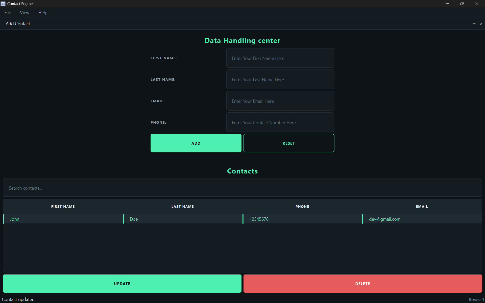
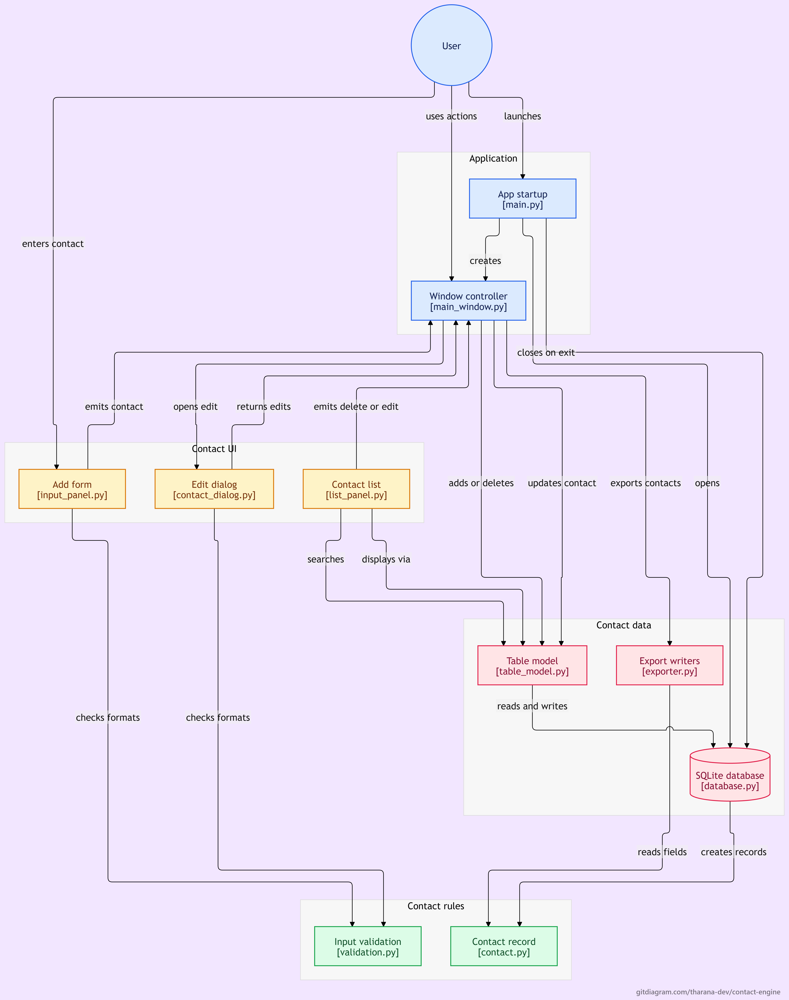

# Contact Engine

A small desktop contact manager built with **PySide6 (Qt for Python)**.
Add contacts through a form, view them in a sortable table, delete them — and
everything persists to a local SQLite database between sessions.



### 🎥 Architecture Trailer

<video src="https://github.com/user-attachments/assets/a724b262-c8d8-419c-812c-860f3f4b4984" controls="controls" style="max-width: 100%;">
</video>

---

---

## Features

- Add contacts (first name, last name, phone, email)
- View all contacts in a `QTableView` backed by a custom `QAbstractTableModel`
- **Edit existing contacts via a dedicated `QDialog`**
- Multi-select and delete contacts
- Live search across names and emails (FTS5 inverted index, 200ms debounce)
- Input validation — Unicode-aware name/email/phone checks with inline error feedback
- Export to CSV, JSON, or vCard via `QFileDialog`
- Instant persistence — every insert/update/delete is committed to SQLite immediately
- WAL mode for concurrent reads
- Indexed columns for fast exact-match lookups
- Dockable input form — move it, float it, close it, or toggle from the View menu
- Menu bar with keyboard shortcuts (`Ctrl+N`, `Ctrl+Q`)
- Status bar with live row counter and action feedback
- Standard OS data paths (AppData) to prevent accidental database deletion
- Window layout and dock positions are remembered between sessions
- Visual empty state when no contacts are present
---

## Requirements

- Python 3.10+ (uses `list[Contact] | None` and `X | Y` type hints)
- PySide6

Install:

```bash
pip install PySide6
```

---

## Running

```bash
git clone https://github.com
cd Contact-Engine
python main.py
```

On first run, a local SQLite database (`contacts.db`) is created automatically in the OS-standard application data directory (e.g., `%APPDATA%\TharanaDev\ContactEngine` on Windows, `~/.local/share/TharanaDev/ContactEngine` on Linux). This prevents accidental deletion and ensures data persists across app updates.
---

## Project Structure
```text
├── tests/
│   ├── test_database.py
│   ├── test_exporter.py
│   ├── test_input_panel.py
│   ├── test_list_panel.py
│   ├── test_mainwindow.py
│   ├── test_table_model.py
│   ├── test_update_dialog.py
│   └── test_validation.py
├── main.py # entry point: builds app, opens DB, shows window
├── main_window.py # QMainWindow: owns model, panels, menus, docks, status
├── input_panel.py # form for entering a new contact
├── contact_dialog.py # QDialog for editing an existing contact
├── validation.py # shared regex patterns and format checkers
├── list_panel.py # QTableView + search box + Update/Delete buttons
├── table_model.py # ContactModel — QAbstractTableModel subclass
├── database.py # SQLite connection, schema, FTS5, all SQL
├── contact.py # Contact dataclass
├── exporter.py        # CSV / JSON / vCard writers
├── validation.py      # Regex patterns and format checks
└── style.qss          # application-wide stylesheet
```


---
## Architecture Overview

Contact Engine is a PySide6 desktop contact manager following a Model-View-Controller (MVC) design pattern. The main workflow validates an added or edited contact, routes it through the main window controller and custom table model, and persists it immediately into an SQLite database. The table view supports debounced search and multi-select deletion, while the controller can invoke export routines to output contacts into CSV, JSON, or vCard formats.



### System Connections & Tracing Evidence

The graph below reflects README-documented capabilities and sampled source files. Edges are strictly limited to relationships visible in the source code or explicitly documented interactions.

| Source Component | Target Component | Action / Relationship | Evidence Base |
| :--- | :--- | :--- | :--- |
| **User** | App startup | Launches application | `README.md` |
| **App startup** | SQLite database | Opens database connection | `main.py` |
| **App startup** | Window controller | Instantiates controller | `main.py` |
| **App startup** | SQLite database | Closes connection cleanly on exit | `main.py` |
| **User** | InputPanel (Add form) | Enters new contact details | `README.md` |
| **InputPanel** | Input validation | Validates formats on submission | `validation.py` |
| **ContactDialog** | Input validation | Validates modified fields on update | `validation.py` |
| **InputPanel** | Window controller | Emits `contact_added` signal | `input_panel.py` / `main_window.py` |
| **User** | Window controller | Triggers menu actions / shortcuts | `README.md` |
| **Window controller**| Table model | Appends or removes rows | `main_window.py` |
| **Window controller**| ContactDialog | Instantiates and opens edit dialog | `main_window.py` |
| **ContactDialog** | Window controller | Returns confirmed updates via `get_data()`| `main_window.py` |
| **Window controller**| Table model | Updates existing contact entry | `main_window.py` |
| **ListPanel** | Table model | Dispatches debounced FTS5 search | `list_panel.py` |
| **ListPanel** | Window controller | Emits mutation requests (delete/edit) | `main_window.py` |
| **ListPanel** | Table model | Displays core dataset via view binding | `README.md` |
| **Table model** | SQLite database | Performs atomic reads and writes | `table_model.py` |
| **SQLite database** | Contact record | Materializes row data into object records| `database.py` |
| **Window controller**| Export writers | Hands off dataset to export pipeline | `main_window.py` |
| **Export writers** | Contact record | Reads fields sequentially to stream files | `exporter.py` |

The app follows a **model / view / controller** split with a clean data layer
underneath.

### `contact.py` — the domain model

A single frozen dataclass:

- **`Contact`** — holds `id`, `first_name`, `last_name`, `phone`, `email`.
  Strips whitespace and rejects blank fields at construction time.

The `id` field is `int | None` — `None` before the contact is saved, and the
DB-assigned primary key afterward.

### `database.py` — the data layer

- **`Database`** — owns the SQLite connection. Enables WAL mode and
  `synchronous=NORMAL` on startup, creates the schema, indexes, FTS5 virtual
  table, and sync triggers if missing. All SQL in the project lives here.

Methods:

```python
insert_contact(first, last, phone, email) -> Contact
fetch_all() -> list[Contact]
delete_contacts(ids: list[int]) -> None
search(query: str) -> list[Contact]
close() -> None
```

No Qt. No display. Just SQL and `Contact` objects.

### `table_model.py` — the Qt view model

- **`ContactModel(QAbstractTableModel)`** — bridges `Database` and `QTableView`.
  Loads all contacts once at construction, then holds them in memory. Adds and
  removes go through the database first, then update the in-memory list with
  proper `beginInsertRows` / `endInsertRows` / `beginRemoveRows` /
  `endRemoveRows` signals so the view redraws correctly.

  ### `validation.py` — shared input rules

Pure functions and regex patterns used by both the Add form and the Edit dialog.
- `regex_patterns` — a dictionary of the character-level masks (e.g., allowing only digits and dashes in phone fields).
- `is_valid_email(text) -> bool` / `is_valid_phone(text) -> bool` — format checks run on submit to catch structural errors that character masks cannot (like missing an `@`).

Keeping these in one place prevents duplication between the dock panel and the dialog.

### `contact_dialog.py` — the edit dialog

A `QDialog` subclass designed for a single, focused task: editing one contact.
- Takes a `Contact` object on construction and pre-fills its fields.
- Uses the shared `validation.py` rules before allowing the dialog to close.
- Has two buttons: **Update** (calls `self.accept()`) and **Cancel** (calls `self.reject()`).
- Exposes `get_data()` so `MainWindow` can retrieve the four edited strings after the dialog closes.

Unlike the persistent dock panel, this dialog is transient — it blocks the main window until the user finishes or cancels.

Public mutation methods:

```python
add_contact(first, last, phone, email) -> Contact
remove_contacts(rows: list[int]) -> None   # rows translated to ids internally
load_all() -> None                          # re-fetch all from the DB
search(query: str) -> None                  # replace in-memory list with FTS5 results
```

**Why rows vs ids matters:** the view talks in row indices (0, 1, 2, ...) but
the DB is keyed by id. `remove_contacts` translates — it maps each row to the
corresponding `Contact.id`, deletes by id in a single SQL statement, then
removes from the in-memory list iterating in descending order.

### `input_panel.py` — the form view

A `QWidget` with four `QLineEdit`s and Add / Reset buttons. Each field has a
`QRegularExpressionValidator` blocking invalid characters at the keystroke
level, plus format checks on submit (email structure, phone length) that
surface as inline error labels.

Emits one signal:

```python
contact_added = Signal(str, str, str, str)   # (first, last, phone, email)
```

It never touches the data. It emits; someone else decides what happens.

### `list_panel.py` — the table view

A `QWidget` with a `QTableView`, a search box, and a Delete button. The panel
is a dumb shell — it doesn't hold data and doesn't refresh. It receives a
`ContactModel` via `set_model()`, and Qt handles all display updates through
the model's signals. The search box is debounced via a 200ms single-shot
`QTimer` and calls `model.search()` on timeout.

Emits one signal:

```python
delete_requested = Signal(list)   # list of selected row indices
```

### `exporter.py` — the export writers

- **`Exporter`** — takes a `list[Contact]` and writes to a caller-supplied path
  in one of three formats.

Methods:

```python
write_to_csv(path: str) -> None
write_to_json(path: str) -> None
write_to_vcard(path: str) -> None
```

Use code with caution.
No Qt. No display. All three open with encoding="utf-8" so accented
characters survive the round trip. CSV uses the csv module for escaping;
JSON streams one element at a time with manual bracket/comma handling; vCard
writes one BEGIN:VCARD / END:VCARD block per contact.

### `main_window.py` — the controller

Owns the `Database`, the `ContactModel`, both panels, the menu bar, the status bar, the dock, and the export handlers. Its job is to wire everything:

* `InputPanel.contact_added` → `model.add_contact(...)` → update counter → status message.
* `ContactListPanel.delete_requested` → `model.remove_contacts(rows)` → update counter → status message.
* Export actions → `QFileDialog.getSaveFileName` → `Exporter` → status message.

No refresh calls. The model emits the right signals and Qt redraws only what changed.

### `main.py` — the process

Opens the `Database`, passes it to `MainWindow`, wires `db.close` to `app.aboutToQuit`. Knows nothing about widgets.

---

## Layout

The window uses `QMainWindow` slots:

* **Central widget** — the contact table (always visible)
* **Top dock** — the input form (`QDockWidget` wrapping `InputPanel`)
* **Menu bar** — File (New Contact, Export → CSV/JSON/vCard, Exit) / View (toggle input form) / Help (About)
* **Status bar** — permanent row counter on the right, transient feedback messages on the left

The input dock is user-rearrangeable — drag it to any edge or float it as a separate window.

---

## Data Flow

### User clicks Add
1. `InputPanel` validates formats, then emits `contact_added(first, last, phone, email)`.
2. `MainWindow._add_contact` receives the signal data.
3. `ContactModel.add_contact(...)` is called:
   * Triggers `Database.insert_contact(...)` (Executes SQL `INSERT`, returns `Contact` record with its new ID).
   * Calls `beginInsertRows`, appends the record to the in-memory array, and calls `endInsertRows`.
4. The live counter label updates and the status bar displays feedback.

### User selects rows and clicks Delete
1. `ContactListPanel` emits `delete_requested([rows])` with selected indices.
2. `MainWindow._delete_contact` catches the request.
3. `ContactModel.remove_contacts(rows)` handles processing:
   * Translates the interface view row indices into unique primary database IDs.
   * Dispatches `Database.delete_contacts(ids)` (Runs a single atomic `DELETE ... WHERE id IN (...)` statement).
   * Iterates through the collection in **descending order** using `beginRemoveRows` / `del` / `endRemoveRows`.
4. The active window counter label updates and a confirmation shows on screen.

### User types in the search box
1. A `200ms` debounce single-shot `QTimer` restarts tracking on every individual keystroke.
2. On timer timeout, it triggers `ContactModel.search(text)`:
   * Calls `Database.search(text)` (Runs prefix-expanded, sanitized FTS5 `MATCH` queries).
   * Fires `beginResetModel`, swaps out the in-memory array data, and closes with `endResetModel`.
3. The UI table automatically redraws with matching entries and the count total adjusts.

### User picks File → Export → CSV / JSON / vCard
1. Shows the save destination prompt via `QFileDialog.getSaveFileName`.
2. If the user cancels the modal window, the routine safely exits early.
3. Automatically appends the matching file extension if it is missing from the target name.
4. Executes `Exporter(contacts).write_to_<format>(path)`.
5. The status bar confirms success or surfaces a `QMessageBox` error upon catching an `OSError`.

### User selects a row and clicks Update
1. `ContactListPanel` handles the interaction and emits `edit_requested(row)`.
2. `MainWindow._edit_contact` opens a transient `ContactDialog` populated with the current entry details.
3. The user modifies text inputs; the modal carries out internal regex validation checks upon hitting save.
4. `MainWindow` safely captures the modified strings via `dialog.get_data()`.
5. `ContactModel.update_contact(row, updated_contact)` executes internal data tasks:
   * Updates the records on disk via `Database.update_contact(...)`.
   * The SQLite FTS5 database sync trigger fires automatically to maintain search parity.
   * Dispatches a `dataChanged` layout update signal.
6. The data table redraws changes and flashes tracking status updates.

> **Why descending order for deletes?** Deleting row 1 first would dynamically shift row 5 down into index position 4. Processing collections in reverse prevents index mismatch errors.

---

## Persistence

SQLite, not JSON.

* **On startup:** `main.py` uses `QStandardPaths` to locate the OS-specific application data directory, then opens `contacts.db` there. `Database.__init__` enables WAL mode, applies `synchronous=NORMAL`, and creates the table and indexes if missing. Idempotent — safe to run every launch.
* **On every mutation:** `ContactModel` calls `Database.insert_contact` or `Database.delete_contacts`, each wrapped in a transaction. The data hits disk immediately. A crash loses nothing.
* **On quit:** `db.close()` on `aboutToQuit` releases the connection cleanly.

The main schema:

```sql
CREATE TABLE Contacts (
    id          INTEGER PRIMARY KEY,
    first_name  TEXT,
    last_name   TEXT,
    phone       TEXT,
    email       TEXT
);

CREATE INDEX idx_contacts_first_name ON Contacts(first_name);
CREATE INDEX idx_contacts_last_name  ON Contacts(last_name);
CREATE INDEX idx_contacts_email      ON Contacts(email);
```

A parallel FTS5 virtual table (`contacts_fts`) indexes `first_name`, `last_name`, and `email` in external-content mode, kept in sync by three triggers. `search()` queries it with `MATCH`.

WAL mode enables concurrent reads while a write is in progress.

background sync lands in a later version.

---

## Keyboard Shortcuts

| Shortcut | Action |
| :--- | :--- |
| `Ctrl+N` | Show the input dock and focus the first field |
| `Ctrl+Q` | Quit |

---

## Extending

The architecture is designed so features can be **added**, not **restructured**:

* **Click a row to edit** – read `selectionModel().selectedRows()` in the panel, emit an `edit_requested(Contact)`, populate the form.
* **Confirm before delete** – wrap the delete handler in a `QMessageBox.question`.
* **Import from CSV / vCard** – a `QFileDialog.getOpenFileName`, a parser that yields `Contact` objects, then `model.add_contact` in a loop.
* **Sort by column** – implement `sort()` on the model, or wrap it in a `QSortFilterProxyModel`.
* **Streamed export for large datasets** – replace the JSON writer's build-then-write with a generator pipeline.

---

## Versions

| Tag | Highlights |
| :--- | :--- |
| `v0.1` | Initial release — tabs layout, save on close, JSON persistence |
| `v0.2` | Dock-based layout, menu bar, status bar, save on mutation |
| `v0.3` | Code structure cleanup and color palette |
| `v0.4` | SQLite persistence, `QAbstractTableModel`, `QTableView`, WAL mode |
| `v0.4.1` | Table styling pass, form layout fixes |
| `v0.5` | FTS5-backed search with debounce, live filtering |
| `v0.5.1` | Input validation — regex validators, inline error feedback |
| `v0.5.2` | Cleanup pass — no new features, code and QSS tidy |
| `v0.6` | Export engine — CSV, JSON, and vCard with file dialog |
| `v0.6.1` | Refactor — unified export handlers |
| `v0.7` | Edit existing contacts via dialog, shared validation module |
| `v0.7.1` | Database moved to OS-standard AppData directory |
| `v0.7.2` | Window layout persistence, visual empty state |
| `v0.7.3` | UI Polish: custom app icon, fixed-size message boxes, dark theme dialogs. |
| `v0.7.4` | UI Polish: integrated premium Spruce & Mint sub-theme, resolved QDialog field overlapping, updated README screenshots. |
| `v0.8` | Comprehensive test suite (64 tests) covering UI, DB, and E2E |

---

## Testing

The project uses `pytest` and `pytest-qt` to ensure stability across the UI, database, and controller layers.

```bash
# Run the full suite
pytest -v
```

**What is tested:**
- **Database Layer:** CRUD operations, FTS5 search, trigger-based sync.
- **Table Model:** Signal emissions (`dataChanged`, `rowsInserted`), data roles, and index bounds.
- **UI Components:** Field validation, debounce timers, empty state switching, and selection logic.
- **Main Window (E2E):** Mocked file dialogs, mocked message boxes, window layout persistence (QSettings), and modal dialog interactions (using `QTimer.singleShot`).

---

## Known Limitations

* No column sorting yet (planned for Phase 2)
* Single database file for all contacts (no multi-address-book support)
* Export loads the full contact list into memory (fine for desktop scale; streaming needed for 500k+ rows)